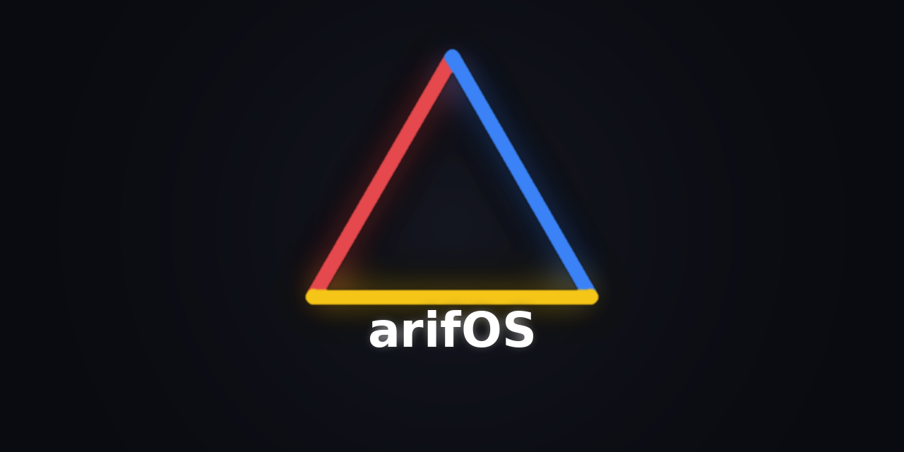

<a id="current-verified-state"></a>
<!-- GENERATED:CURRENT-STATE:BEGIN · source: scripts/generate_current_state.py · never hand-edit -->
> ### ⚠️ Current verified state — generated, never hand-edited
>
> **Runtime self-measurement** (`http://127.0.0.1:8088/health @2026-10-20T00:42:22Z`): kernel **degraded** · floors **9/13 measured pass** · failing: F1, F8 · vault999 healthy · release `arifos-7628a9a` · drift `aligned` (source=built=deployed) · tools exposed 8. Per-floor provenance: `.well-known/current-state.json`.
>
> **Independent audit** (2026-10-11, live re-probe by FI-008 + claim-level hand audit; receipts: `AAA/forge_work/grant-arifos-reality-reforge-2026-10-11/`): floors **2 pass · fail F2, F11, F12, F13 · 7 unmeasured = 13 distinct** (raw key-count 10 includes L11/L12/L13, L-prefix aliases of the failing F11/F12/F13) · actor binding not verified (observed calls unsigned) · receipt fidelity broken on invocation-telemetry surface (HOLD persisted as ok:true) · independent reconstruction: no external verifier bound.
>
> **These are two different witness objects.** Self-measurement ≠ independent audit;
> unmeasured is not pass. If this block conflicts with the live endpoint, the endpoint
> wins — re-run `python scripts/generate_current_state.py`.
>
> Machine state: [`.well-known/current-state.json`](./.well-known/current-state.json) ·
> Badge feed: [`.well-known/badges/`](./.well-known/badges/) ·
> Known gaps: [What Is Not Yet Proven](#what-is-not-yet-proven)
<!-- GENERATED:CURRENT-STATE:END -->

<!-- SOT-MANIFEST
last_verified: 2026-10-18T10:20:00+00:00
live_commit: 9e6477d08 (docs(test): correct stale auto-sign claim in identity-proof P0 test)
source_commit: 9e6477d08
built_commit: cf7a984
deployment_drift_status: aligned (source = built = deployed (drift: false))
tools_exposed_via_mcp: 8 (verified by live tools/list, 2026-10-18)
truth_rule: live :8088/health + tools/list beat any static count in prose — re-run before you quote this file
generated_by: scripts/update_readme_sot.py re-stamps live_commit, source_commit, built_commit, deployment_drift_status and last_verified; every other machine value in this README lives in the generated block above
-->

<p align="center">
  
</p>

# arifOS

### Authority before execution.

**arifOS is a model-independent authority plane for AI agents.** It evaluates consequential proposals against thirteen constitutional floors *before* execution, returns a governed verdict, preserves the human veto, and records what happened as an auditable receipt.

In a world where intelligence is abundant, authority becomes the scarce resource. arifOS keeps judgment independent from execution.

[Quick Start](#30-second-proof) · [MCP Endpoint](#connect-an-mcp-client) · [Current Verified State](#current-verified-state) · [Agent surfaces](#machine-readable-surfaces) · [Known Gaps](#what-is-not-yet-proven) · [Security](./SECURITY.md)

[](./CURRENT_VERIFIED_STATE.md)
[](https://pypi.org/project/arifos/)
[](https://glama.ai/mcp/connectors/io.github.ariffazil/arifos)
[](https://github.com/ariffazil/arifOS/actions/workflows/01-unified-ci.yml)
[](./SECURITY.md#known-gaps)
[](./LICENSE)

> **Proposer ≠ Judge ≠ Executor ≠ Witness**
> **Human sovereignty > machine authority**

**What arifOS is not:** not an AI model · not an agent framework · not an execution engine (A-FORGE executes) · not an attention plane (AAA attends) · not the witness (FRAME witnesses; VAULT999 remembers) · not a substitute for authentication, sandboxing, or legal review.

| Audience | What you get |
|---|---|
| **Human** | A quiet veto: the agent proposes, the kernel records a verdict, you stay sovereign |
| **Agent / A2A** | MCP tools + receipts. You do not get the keys. Judgment by arifOS, discovery by AAA, execution by A-FORGE |
| **Institution** | Policy floors F1–F13, a hash-chained VAULT999 audit trail, model-vendor independence |
| **Machine / MCP** | [Streamable HTTP endpoint](https://mcp.arif-fazil.com/mcp), 8 canonical verbs, [published schemas](https://arifos.arif-fazil.com/tools.json) |
| **Auditor / indexer** | [`CURRENT_VERIFIED_STATE.md`](./CURRENT_VERIFIED_STATE.md) · [`docs/evidence/`](./docs/evidence/) · [`llms.txt`](./llms.txt) · [`CITATION.cff`](./CITATION.cff) |

Live: `https://arifos.arif-fazil.com` · MCP `:8088` · sister organs [AAA](https://github.com/ariffazil/AAA) · [A-FORGE](https://github.com/ariffazil/A-FORGE) · [GEOX](https://github.com/ariffazil/GEOX)

---

## Who built this

arifOS was built by Arif Fazil, a senior exploration geoscientist who spent his career making decisions where observations are incomplete, interpretations are probabilistic, provenance matters, and irreversible action must be gated. He transferred that discipline into agent runtime governance.

**I am a geologist, not a programmer.** I did not write this codebase and I do not read it line by line. What I do is point at where the problem is — and the agents in my federation solve it, inside the constitution and the review gates I set, with the commit trail to show who ran what.

Read the commits if you want to check that claim: the author fields are agent handles, not aliases of mine. That is the deliberate shape of this project, not a detail being hidden. It also sets the honest expectation — the design and the judgment are mine, the implementation is theirs, and where the two disagree, the bug is mine to answer for.

The system is named after its founder and reflects a core belief: **governance is a systems problem, not a model problem.**

One human, and the agents he directs.

---

## 30-second proof

```bash
pip install arifos
python examples/enterprise_operations_demo.py
```

Three of the six graded scenarios:

```text
Read customer account data        → SEAL   (receipt RCPT-…)
Major refund (50× the ceiling)    → HOLD   (awaiting human)
Delete account + audit trail      → VOID   (blocked by a hard floor)
```

Full transcript: [`docs/QUICKSTART.md`](./docs/QUICKSTART.md). The demo runs in-process — no real records or funds are touched.

---

## What works today

- **Deterministic rejection without consulting an LLM.** The judge refuses on the constitution, not on a model opinion (`gate: hard_deterministic`, `llm_consulted: false`).
- **Prevention of a tested unauthorised mutation.** One MUTATE-class call without presented authority was stopped before execution.

## What is not yet proven

Every row names its own gap. Repairing a claim by substituting a stronger one is worse than the stale claim it replaced. (Closed rows are receipted in [`docs/evidence/GAP_HISTORY.md`](./docs/evidence/GAP_HISTORY.md).)

| Gap | Risk | Status |
|---|---|---|
| Independent security audit | Adversarial bypass testing not published | **In progress** — external researcher reviewing since 2026-08-25. Findings so far: fetch-surface SSRF (fixed, `1!2026.9.1`); Cypher injection (HIGH — key whitelist landed) and fastmcp path traversal (MEDIUM — containment guard landed). See [SECURITY.md](./SECURITY.md#known-gaps) |
| **Sovereign-binding of irreversible acknowledgement** | `ack_irreversible` and `actor_signature` are transported as payload fields; nothing published shows a human signature bound to `(transaction_hash ‖ state_hash ‖ nonce)`, single-use, scoped, unforgeable by the proposing agent | **Open** — design drafted ([`docs/judgment-integrity-2026-09-22/`](./docs/judgment-integrity-2026-09-22/ARIFOS_AUTHORITY_SERVICE_DESIGN.md)), not implemented. F13 is enforced by convention and band-gating, not cryptographic transaction binding |
| **Ledger head not externally anchored or signed** | A hash chain held entirely by one party cannot detect wholesale rewrite by that party | **Open** — VAULT999 today is self-verifiable, not independently attestable |
| Third-party evaluation | No external reviewer has published findings | In progress since 2026-08-25; nothing published |
| Reproducible demo by strangers | Onboarding path not independently tested | **Partial** — demo verified here; no stranger has reproduced it unaided |
| Enterprise deployment | No production customer reference | Open |
| Standards conformance | MCP/A2A results not published externally | **Partial** — [report](docs/evidence/conformance-report.json): `result: PARTIAL`, per-tool schema validation DEFERRED |
| SBOM and signed releases | Supply-chain integrity unverified externally | **Partial** — CycloneDX on publish; no signing, no CVE scan |
| Test suite | Needs a live kernel (`tests/conftest.py` refuses without `:8088`, by design) | 7,668 tests collect clean (2026-10-05); the identity/authority subset carries 34 pre-existing failures vs 321 passes (2026-09-30) — quote a failure *set*, never a bare pass count |
| Observability | Tracing partially wired | **Partial** — sovereign Postgres + arifFlow live; OTel spans on all 8 verbs; caller-side propagation incomplete |
| Semantic layer (Graphiti) | Knowledge graph retired from the read path | `graphiti_read: retired_888` (2026-09-04); semantic floor disabled by choice (`ARIFOS_ML_FLOORS=0`) |
| Comparative benchmark | No published comparison against alternative frameworks | Open |
| Maintainer continuity | Single sovereign, single reviewer; no succession or key-recovery procedure published | **Open — relevant to institutional adoption** |
| Identity registry in two copies | `contracts/identity.py` ↔ `arifosmcp/contracts/identity.py` had diverged; a one-sided edit ships split-brain identity | **Mitigated 2026-09-30** (tripwire tests, 18 actors aligned) — consolidation to one owner still open |

See [SECURITY.md](./SECURITY.md) for the threat model and disclosure policy, and [docs/evidence/claims.yaml](./docs/evidence/claims.yaml) for the machine-readable claim registry.

---

## How it works

```
  Agent proposes action
         │
         ▼
  ┌─────────────────┐
  │   arifOS Kernel  │  Evaluates against 13 constitutional floors
  │     (:8088)      │  Records provenance + evidence refs + hashes
  └────────┬────────┘
           │
    ┌──────┼────────┬──────────┬───────────┐
    ▼      ▼        ▼          ▼           ▼
  SEAL    HOLD    SABAR     PARTIAL      VOID
  (go)  (wait for (defer —  (proceed   (blocked by
        human)    evidence   with       a floor)
                  pending)   cooling)
    │      │
    ▼      ▼
  Execute  Human
  via      reviews
  A-FORGE
    │
    ▼
  Receipt in VAULT999 (append-only hash chain)
```

**The judge never executes. The executor never certifies.**

### The verdict lattice

Verdicts are ordered and non-compensatory — a stronger verdict always dominates a weaker one (`arifosmcp/models/verdicts.py`):

```
VOID  >  HOLD_888  >  HOLD  >  SABAR  >  PARTIAL  >  PROVISIONAL  >  SEAL
```

| Verdict | Plain English | What happens |
|---------|---------------|-------------|
| **SEAL** | Go | Proceed to execution |
| **PARTIAL** | Go carefully | Proceed with cooling and monitoring |
| **PROVISIONAL** | Proceed with expiry timer | Auto-revoke at `valid_until`; no extension without re-judging |
| **SABAR** | Wait for evidence | Retry permitted later; distinct from HOLD |
| **HOLD** | Wait for human | Pause; await a human decision |
| **HOLD_888** | Stop — the sovereign decides | Escalate to F13 |
| **VOID** | Blocked | Stop; the constraint must be resolved |

Floors are never averaged. One floor failure propagates into the verdict; there is no compensating score.

### 13 Constitutional Floors (F1–F13)

| Floor | Name | Rule (essence) |
|---|---|---|
| F1 | AMANAH | Reversible first. Irreversible → 888_HOLD unless the sovereign acknowledges |
| F2 | TRUTH | P(truth) ≥ 0.99; evidence carries OBS/DER/INT/SPEC labels |
| F3 | TRI-WITNESS | W₃ = ∛(Human × AI × Earth) ≥ 0.75 at judgment; W³ ≥ 0.95 for SEAL |
| F4 | CLARITY | ΔS ≤ 0 — every output reduces entropy |
| F5 | PEACE² | Non-destructive power — block harm and extraction |
| F6 | EMPATHY (kernel: MARUAH) | Protect the weakest stakeholder; dignity is not tradeable |
| F7 | HUMILITY | Ω₀ ∈ [0.03, 0.05] — in-band pass, no fake certainty |
| F8 | GENIUS | G ≥ 0.80 for complex actions — the simplest correct path |
| F9 | ANTIHANTU | No deception, manipulation, or consciousness claims (lower = better) |
| F10 | ONTOLOGY | AI-only ontology; a soul claim is VOID |
| F11 | AUDITABILITY | Every decision logged, inspectable, attributable |
| F12 | RESILIENCE | Injection defence; input risk < 0.85 (lower = better) |
| F13 | SOVEREIGN | Human veto is FINAL |

Three semantic classes: **score floors** (higher ≥ threshold), **band floors** (F7 in-band), **ceiling floors** (F9, F12 lower = better). Full canonical rules: [`FEDERATION_CONTRACT.md` §3](./FEDERATION_CONTRACT.md) · `GENESIS/000_KERNEL_CANON.md`.

### VAULT999 — the record

Every consequential verdict and receipt is written to VAULT999: a hash-chained, append-only JSONL ledger set — **tamper-evident by construction, not tamper-proof**. An entry carries payload hash, entry hash, previous hash, trace root, actor, session and evidence references; source payloads are not copied in.

**A hash chain proves internal consistency — not freedom from rewrite by whoever holds the ledger.** External anchoring (published chain head, external signing) is not implemented: VAULT999 today is self-verifiable, not independently attestable. Census methods and counts: [`docs/evidence/VAULT_CENSUS.md`](./docs/evidence/VAULT_CENSUS.md) (quote the timestamp with any count).

---

## Connect an MCP client

```
https://mcp.arif-fazil.com/mcp      # canonical public door · or http://localhost:8088/mcp self-hosted
```

**Canonical endpoint:** `https://mcp.arif-fazil.com/mcp`. `https://arifos.arif-fazil.com/mcp` is a live alias (proxies to the same kernel); use the canonical URL in client configs.

<details>
<summary><strong>Client config</strong> — Cline · Cursor · Windsurf · Claude Desktop</summary>

Cline — `cline_mcp_settings.json`:
```json
{ "mcpServers": { "arifos": { "type": "streamableHttp", "url": "https://mcp.arif-fazil.com/mcp" } } }
```
Cursor — `~/.cursor/mcp.json`:
```json
{ "mcpServers": { "arifos": { "url": "https://mcp.arif-fazil.com/mcp" } } }
```
Windsurf — `mcp_config.json` (note: `serverUrl`, not `url`):
```json
{ "mcpServers": { "arifos": { "type": "streamable-http", "serverUrl": "https://mcp.arif-fazil.com/mcp" } } }
```
Claude Desktop — stdio bridge to the HTTP door:
```json
{ "mcpServers": { "arifos": { "command": "npx", "args": ["-y", "mcp-remote", "https://mcp.arif-fazil.com/mcp"] } } }
```

</details>

**Protocol facts, as measured:** the kernel advertises `2026-07-28` and accepts `2026-07-28 · 2025-11-25 · 2025-03-26 · 2024-11-05`; a live `initialize` currently settles on **`2025-11-25`** — pin that if you pin anything.

```bash
curl -s http://localhost:8088/mcp \
  -H 'content-type: application/json' -H 'accept: application/json, text/event-stream' \
  -d '{"jsonrpc":"2.0","id":1,"method":"tools/list","params":{}}'
# → 8 tools: arif_init arif_observe arif_think arif_route arif_memory arif_judge arif_forge arif_seal
```

### Session flow (agents start here)

The kernel binds a session before any judgment:

```jsonc
// 1 — arif_init: actor identity + authority band (HOLD is the normal starting state)
{ "name": "arif_init", "arguments": { "mode": "init", "actor_id": "my-agent", "intent": "…" } }
// 2 — arif_judge: evaluate a proposal → verdict + evidence + next_safe_action
{ "name": "arif_judge", "arguments": { "candidate": "Delete the production audit table", "action_tier": "standard", "session_id": "…", "actor_id": "my-agent" } }
// 3 — arif_seal: only after a SEAL verdict; appends the receipt to VAULT999
{ "name": "arif_seal", "arguments": { "payload": "…", "session_id": "…", "ack_irreversible": true } }
```

> Call `arif_judge` without a session and the kernel answers `actor: anonymous`, `authority: OBSERVE_ONLY`, `verdict: HOLD` — it will not silently upgrade an unattested caller.

> **Stage numbering (single source of truth).** The verbs follow the ratified eight-stage map: `000` INIT · `111` OBSERVE · `333` THINK · `444` ROUTE · `555` MEMORY · `666` JUDGE · `777` FORGE · `999` SEAL (`arifosmcp/constitutional_map.py`, F13-ratified 2026-07-31). The retired `888` judge label survives only in historical mirrors; the live wire says `666`.

Guided walkthrough: [docs/START_HERE.md](./docs/START_HERE.md) · verified [docs/QUICKSTART.md](./docs/QUICKSTART.md).

### Machine-readable surfaces

| Surface | URL | For |
|---|---|---|
| MCP tool schemas | [tools.json](https://arifos.arif-fazil.com/tools.json) | agents, registry crawlers |
| Agent context | [`llms.txt`](./llms.txt) · [`AGENTS.md`](./AGENTS.md) | coding agents |
| Citation | [`CITATION.cff`](./CITATION.cff) | institutions, researchers |
| Truth badges | [`.well-known/badges/`](./.well-known/badges/) | status dashboards |
| Current state | [`.well-known/current-state.json`](./.well-known/current-state.json) | automation |

---

## Architecture

```
arifOS Federation — planes and classes

    ┌───────────────────────────────────────────────────┐
    │  Authority plane — arifOS :8088                    │
    │  Constitutional judgment · F1–F13 · VAULT999        │
    └──────────────────────┬────────────────────────────┘
                           │
    ┌──────────────────────▼────────────────────────────┐
    │  Attention plane — AAA :3001                       │
    │  What matters · routing · state · skill catalog    │
    └──────────────────────┬────────────────────────────┘
                           │
    ┌──────────────────────▼────────────────────────────┐
    │  Execution plane — A-FORGE :7071/:7072             │
    │  Governed mutation · leases · receipts             │
    └──────────────────────┬────────────────────────────┘
                           │
    ┌──────────────────────▼────────────────────────────┐
    │  Witness + record — FRAME :18085 · VAULT999        │
    │  Independent observation · immutable history       │
    └───────────────────────────────────────────────────┘
        boundaries:  HERMES :18087 (semantic) · CHRON :18102 (temporal)
        domains:     GEOX :8081 · WEALTH :18082 · WELL :18083
        metabolism:  arifFlow :7073      gateway: FED :7074      synthesis: i-ARIF
```

| Plane / class | Component | Role |
|---|---|---|
| Authority | **arifOS** `:8088` | Constitutional judgment — owns the gavel and the ledger |
| Attention | **AAA** `:3001` | What matters, and to whom. Displays, routes, queues; never adjudicates |
| Execution | **A-FORGE** `:7071`/`:7072` | Governed mutation — leases, gates, receipts |
| Witness | **FRAME** `:18085` | Independent observer. Its output is evidence, never a verdict |
| Record | **VAULT999** (in-kernel) | Immutable append-only ledger |
| Metabolism | **arifFlow** `:7073` | Receipt ingestion, FQ monitoring; never adjudicates |
| Domain intelligence | **GEOX** `:8081` · **WEALTH** `:18082` · **WELL** `:18083` | Domain evidence and computation. Compute-only: no organ authorises its own action |
| Provider gateway | **FED** `:7074` | Multi-provider model routing (advisory-only) |
| Boundary services | **HERMES** `:18087` · **CHRON** `:18102` | Semantic and temporal boundaries — not organs ([FEDERATION_CONTRACT.md §2.1](./FEDERATION_CONTRACT.md)) |

**Tool-count semantics** (so no two surfaces disagree): `tools_loaded = 8` — the public MCP facade (KERNEL_ABI_8), the only number to quote publicly · `canonical superset = 25` (8 public ABI + 4 map-only verbs: `arif_fetch`, `arif_challenge`, `arif_stage`, `arif_measure` + 13 hidden verbs) · `total_declared = 48` (8 canonical + 40 diagnostic) · `registry = 62` (with aliases) · `operational = 3` (durable SUCCESS in the last 24 h — proven live, not merely invocable).

---

## Verification Status

Dynamic values live in the [generated block](#current-verified-state) at the top of this file — this table names **how** each surface is verified, not stale copies of the numbers.

| Surface | How to verify |
|---------|--------|
| Public repository | GitHub [`ariffazil/arifOS`](https://github.com/ariffazil/arifOS), AGPL-3.0 |
| PyPI package | `pip install arifos` → [pypi.org/project/arifos](https://pypi.org/project/arifos/) |
| Live kernel + floors | `curl localhost:8088/health` → status, per-floor provenance |
| MCP interface | live `tools/list`; protocol negotiation note above |
| VAULT999 ledger | [`scripts/verify_vault_chain.py`](./scripts/verify_vault_chain.py) (scope: the active ledgers under `arifOS/VAULT999/`); census methods in [`docs/evidence/VAULT_CENSUS.md`](./docs/evidence/VAULT_CENSUS.md) |
| Source / build / deploy | `/health → software_release` (drift flag) · re-attested on every `scripts/deploy-release.sh` run |
| Contract schema | `contract_status` in `/health` |
| Machine-readable | [tools.json](https://arifos.arif-fazil.com/tools.json) · [llms.txt](./llms.txt) · [CITATION.cff](./CITATION.cff) |
| Scanner attestation | [mcp.arif-fazil.com/proof/](https://mcp.arif-fazil.com/proof/) |

### Operational gates (CI)

| Workflow | What it guards |
|---|---|
| [Unified CI](https://github.com/ariffazil/arifOS/actions/workflows/01-unified-ci.yml) | build + test |
| [MCP Conformance](https://github.com/ariffazil/arifOS/actions/workflows/06-mcp-conformance.yml) | protocol surface |
| [Vault Integrity](https://github.com/ariffazil/arifOS/actions/workflows/07-vault-integrity.yml) | ledger chain |
| [Floor Gate](https://github.com/ariffazil/arifOS/actions/workflows/floor_gate.yml) | floor evaluation |
| [Governance Gate](https://github.com/ariffazil/arifOS/actions/workflows/governance-gate.yml) | governance contract |
| [Drift Monitor](https://github.com/ariffazil/arifOS/actions/workflows/drift-monitor.yml) | source↔runtime drift |
| [Uptime](https://github.com/ariffazil/arifOS/actions/workflows/04-uptime-monitor.yml) | endpoint liveness |

---

## Sister Repositories

| Repository | Purpose |
|------------|---------|
| [AAA](https://github.com/ariffazil/AAA) | Attention plane — routing, state, skill catalog, A2A gateway |
| [A-FORGE](https://github.com/ariffazil/A-FORGE) | Execution engine after authorisation |
| [GEOX](https://github.com/ariffazil/GEOX) | Earth sciences domain evidence |
| [WEALTH](https://github.com/ariffazil/WEALTH) | Capital and financial intelligence |
| [WELL](https://github.com/ariffazil/WELL) | Human and machine vitality observation |
| [arifFlow](https://github.com/ariffazil/arifFLOW) | Metabolic ledger daemon — FQ monitoring, receipt ingestion |
| [FRAME](https://github.com/ariffazil/FRAME) | Independent observer — drift detection, evidence gathering (repository archived, organ live) |

**No public repository today:** FED (`:7074`) and i-ARIF. They are deployed and reachable, but their source is not published. Treat their behaviour as observed from `/health` only.

---

## Evidence & Trust

arifOS publishes verifiable evidence for its claims. Every public claim links to an artifact that can be regenerated.

| Claim | Evidence | Status |
|---|---|---|
| MCP conformance | [CI](./.github/workflows/06-mcp-conformance.yml) · [report](docs/evidence/conformance-report.json) | **Partial** |
| ABI stability | [Drift guard](./scripts/sync_kernel_abi.py) | **Partial** |
| Floor enforcement | `/health → layer_health.constitutional` (per-floor provenance) | **Verified by self-measurement; independent audit found the gap set above** |
| Vault integrity | [`scripts/verify_vault_chain.py`](./scripts/verify_vault_chain.py) | **Verified** — INTACT within its scope; 2 legacy breaks reported as historical |
| SBOM | [Generator](arifosmcp/arifos_sbom.py) | **Partial** |
| Quickstart | [Verified quickstart](./docs/QUICKSTART.md) | **Verified by the maintainer** 2026-09-21; not yet reproduced by a stranger |

> **Honesty principle:** we publish what passed, what failed, and what remains unknown. We do not claim maturity beyond our evidence.

---

## Who Is This For

**Operators** deploying AI agents in regulated environments who need an independent judgment layer between proposals and execution. **Developers** building agent systems who want a policy decision point as a service. **Evaluators and security reviewers** assessing AI governance frameworks. **Domain builders** adapting governance to a field (geoscience, finance, healthcare).

Start here: [docs/START_HERE.md](./docs/START_HERE.md)

## Development

```bash
git clone https://github.com/ariffazil/arifOS.git
cd arifOS
pip install -e ".[dev]"                       # dev tier — kernel + test tooling
python -m pytest tests/ -q                    # needs a live kernel at :8088 (see gaps)
make health                                   # probe the kernel
PORT=8088 arifos-mcp streamable-http          # start the kernel
python scripts/generate_current_state.py      # re-stamp the generated truth block
```

See [`CODEOWNERS`](./CODEOWNERS) for sovereign ownership of automation surfaces and [`CONTRIBUTING.md`](./CONTRIBUTING.md).

<details>
<summary><strong>Project structure</strong> (the five <code>[wheel root]</code> entries are exactly what ships)</summary>

```
arifOS/
├── arifosmcp/          # Core kernel package                    [wheel root]
│   ├── abi/            # Capability registry and floor definitions
│   ├── constitution/   # Constitutional floor implementations
│   ├── contracts/      # Packaged copy of the identity/verdict contracts
│   ├── kernel/         # Core judgment engine
│   └── VAULT999/       # VAULT999 ledger implementation
├── arifos/             # Phase 3 identity/consent namespace      [wheel root]
├── contracts/          # Runtime contract package                [wheel root]
├── core/               # Load-bearing legacy root                [wheel root]
├── schemas/            # INIT v2 schemas (F13-ratified 2026-09-20) [wheel root]
├── examples/           # Runnable governed workflow demo
├── tests/              # Test suite (pytest)
├── scripts/            # Operational tooling (update_readme_sot.py, generate_current_state.py)
├── .well-known/        # Generated machine state + truth badges (gitignored: state/)
├── docs/               # Documentation + evidence/ + archive/
└── pyproject.toml      # Package metadata — [wheel root] marks packages.find.include
```

Until 2026-09-30 this tree listed only `arifosmcp/` while the runtime imported `contracts.*` at 10 import statements across 5 files — production resolved them only from a `site-packages` leftover that a fresh venv would not have. Fixed in `27409ddbf`. **An incomplete structure diagram is not a cosmetic gap — it is how an unshipped, runtime-critical package stays invisible.** `contracts/` and `arifosmcp/contracts/` are kept in agreement by tripwire tests; consolidating them into one owner is still open.

</details>

## Security

See [SECURITY.md](./SECURITY.md) for the threat model, known vulnerabilities and disclosure policy.

## License

**AGPL-3.0** ([`LICENSE`](./LICENSE)). When deployed over a network, the complete source code must be made available to all users interacting with the service.

---

*Revision 2026-10-17 — APEX-ZEN upgrade: human story moved forward, founding context consolidated, 30-second proof elevated, duplicate "not yet proven" consolidated, "drift aligned" semantics clarified (binary matches build source, not necessarily repo HEAD). Prior revision: 2026-10-16 restructured under AGENTIC-README-DOCTRINE v1. Prior audit passes: 2026-09-21 full re-measurement · 2026-09-22 Copilot external ENTERPRISE · 2026-10-11 independent re-probe · 2026-10-17 four-probe audit (333-AGI + IrfanClaw + ChatGPT + WawaBot).*

**Ditempa Bukan Diberi** — Forged, Not Given.

<!-- FEDERATION-STANDARD v2026-10-17 START :: 333-AGI audit :: source: organs.yaml + git + live probes -->
## 🔗 Federation Identity
| Field | Value |
|---|---|
| Organ | `arifos` · CORE · governance_kernel |
| Ports | 8088 (/mcp) |
| Unit | arifos.service |
| Authority ceiling | JUDGE_ONLY |
| Public MCP | https://mcp.arif-fazil.com/mcp (canonical; live alias: https://arifos.arif-fazil.com/mcp) |
| Flow graph | [FEDERATION.md](https://github.com/ariffazil/AAA/blob/main/FEDERATION.md) — peta semua organ + repo |
<!-- FEDERATION-STANDARD v2026-10-17 END -->